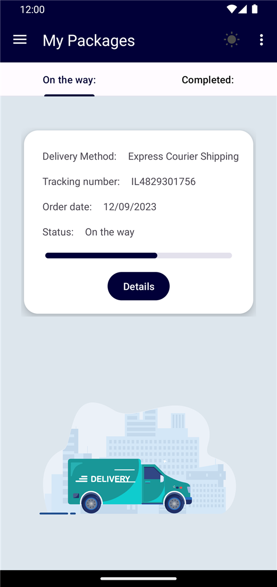
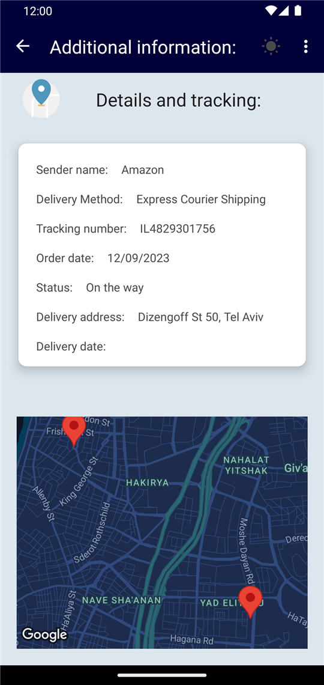
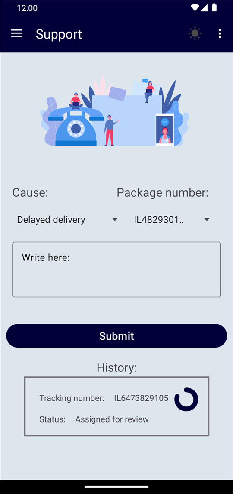
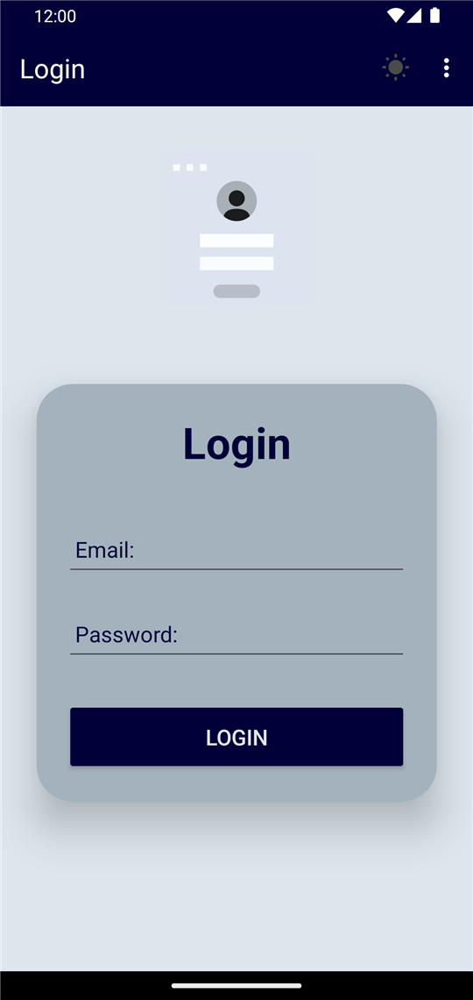
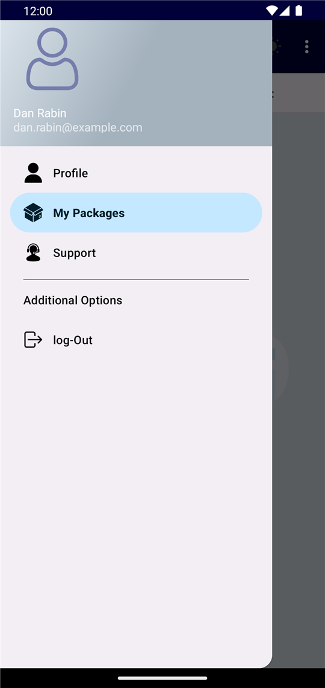
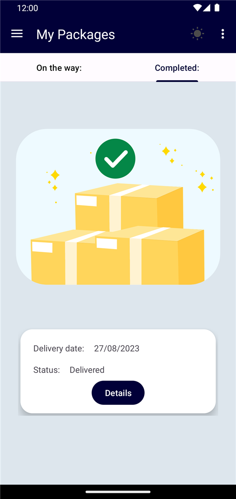
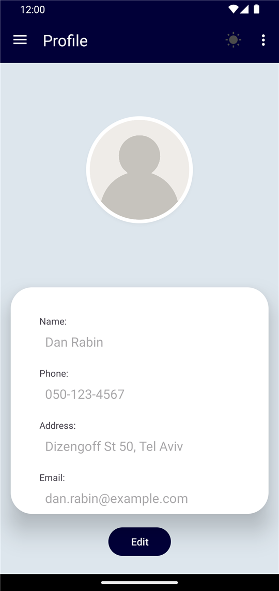
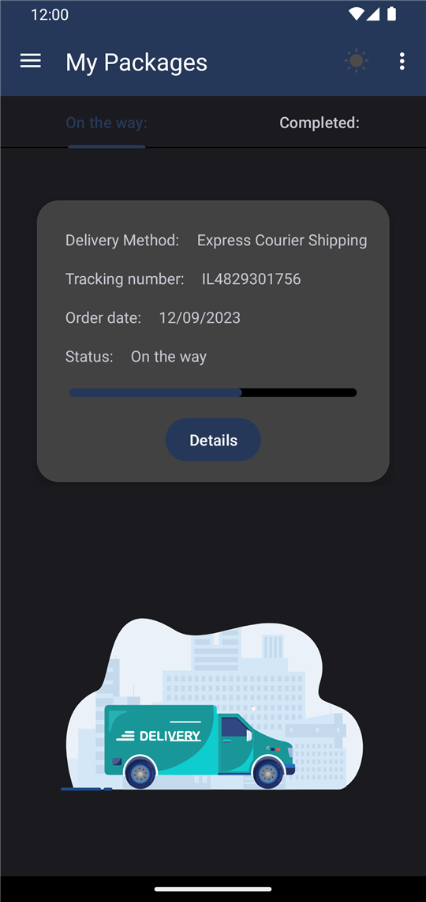
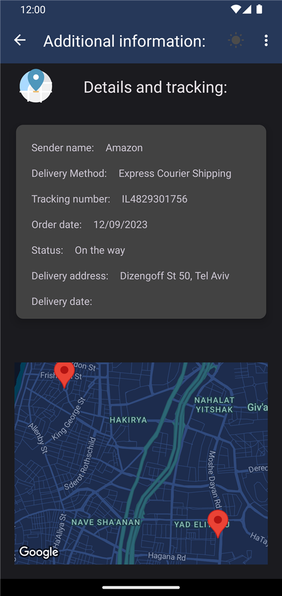
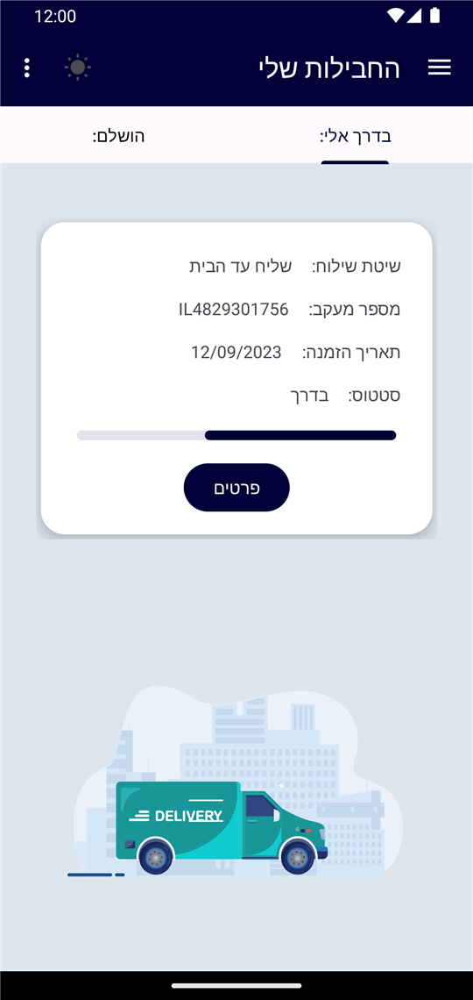

# Parcel Tracker – Android Package Tracking App

An Android app for tracking incoming packages. It shows shipments in transit and completed deliveries, places each parcel on a map, and lets the user open support tickets, all in one place.

Built in Java with Firebase (Authentication, Realtime Database, Cloud Storage) and the Google Maps SDK.

<p align="center">
  
  
  
</p>

## Features

- **Authentication**: email and password sign-in with Firebase Authentication.
- **Package dashboard**: two tabs, *On the way* and *Completed*. Each parcel card has a progress bar that follows its status, from *Arrived at facility* through *On the way* and *Ready for pickup* to *Delivered* or *Collected*.
- **Parcel details and live map**: a Google Maps view with a custom style. Courier deliveries show both the parcel and the user's home, with the camera fitted to both. Pickup-point parcels show the collection point.
- **Customer support**: open a ticket for a specific parcel, pick a cause, describe the issue, and follow each ticket's status in the history list.
- **User profile**: view and edit contact details and upload a profile picture to Firebase Storage. Changing the address also updates every active courier shipment.
- **Localization and theming**: full English and Hebrew (RTL) support, switchable inside the app, plus dark mode.

## Screenshots

| Login | Navigation | Completed |
|:---:|:---:|:---:|
|  |  |  |

| Profile | Dark mode | Dark mode – details |
|:---:|:---:|:---:|
|  |  |  |

| Hebrew (RTL) |
|:---:|
|  |

> The screenshots use sample data.

## Tech Stack

| Area | Technologies |
|---|---|
| Language / platform | Java, Android SDK (min SDK 26, target SDK 33) |
| Architecture & UI | Single activity with fragments, Jetpack Navigation, View Binding, RecyclerView, ViewPager2 with TabLayout, Material Components |
| Backend | Firebase Authentication, Firebase Realtime Database, Firebase Cloud Storage |
| Maps & location | Google Maps SDK for Android, Play Services Location |
| Visuals | Lottie animations, CircleImageView |

## Project Structure

```
app/src/main/java/com/example/final_project_23b11345/
├── Activities/      # MenuActivity: navigation drawer, theme and language switching
├── Adapters/        # RecyclerView and ViewPager adapters
├── Interfaces/      # DataLoader, DetailsCallback
├── Model/           # Parcel, User, SupportRequest, FireBaseLatlng
├── Utilities/       # DataManager (central Firebase access), Notifier, Constants
└── ui/
    ├── Login/
    ├── Packages/    # Tabs (in transit / completed) and details with map
    ├── Profile/
    └── Support/
```

## Getting Started

API keys are **not** committed to this repository. To build the app, provide your own:

1. **Firebase**
   - Create a Firebase project and add an Android app with the package name `com.example.final_project_23b11345`.
   - Turn on **Email/Password** authentication, **Realtime Database** and **Cloud Storage**.
   - Download `google-services.json` and place it in `app/`.
2. **Google Maps**
   - Create a Maps SDK for Android API key in Google Cloud Console.
   - Add it to `local.properties` in the project root:
     ```properties
     MAPS_API_KEY=your_maps_api_key_here
     ```
3. Open the project in Android Studio and run it on a device or emulator (API 26+).
